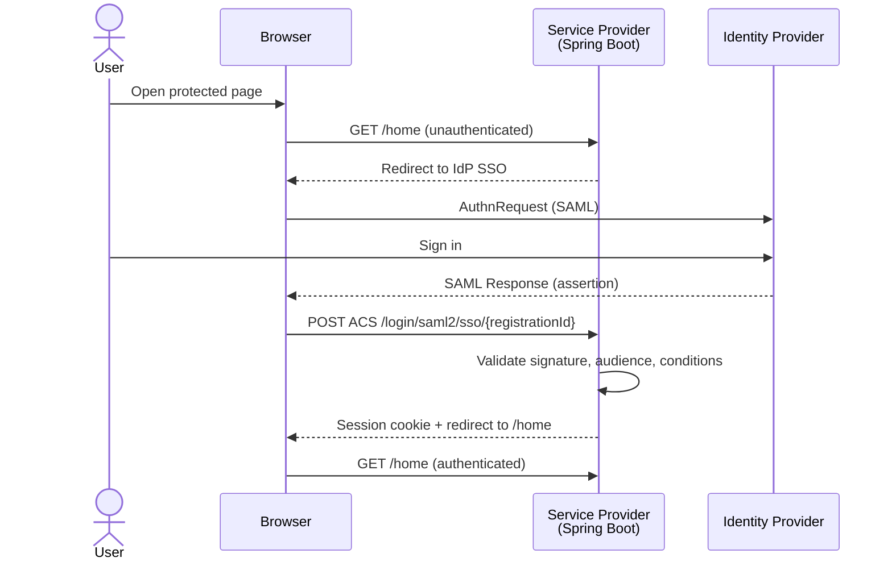

# Chapter 0: SSO And SAML Basics

A short primer before the runnable modules. No code required.

## What You Will Learn

- What SSO means in a browser app
- The difference between an Identity Provider (IdP) and a Service Provider (SP)
- The high-level SAML 2.0 Web Browser SSO flow Spring Security implements
- Where metadata, entity IDs, and the Assertion Consumer Service (ACS) fit in

## SSO In One Minute

**Single Sign-On (SSO)** lets a user authenticate once with a trusted authority, then access multiple applications without re-entering credentials for each one.

In the SAML world:

| Role | Also Called | Responsibility |
| --- | --- | --- |
| Identity Provider | IdP / Asserting Party | Authenticates the user and issues a SAML assertion |
| Service Provider | SP / Relying Party | Trusts the IdP and protects the application |

This repository’s modules are **Service Providers** built with Spring Boot.

## SAML Login Flow

## Key Terms

| Term | Meaning |
| --- | --- |
| Entity ID | Stable identifier for the SP or IdP (often a URL) |
| Metadata | XML describing endpoints, bindings, and certificates |
| ACS | Assertion Consumer Service — SP endpoint that receives the SAML Response |
| Registration ID | Spring Security label for one SP↔IdP pairing (for example `okta`) |
| NameID | Subject identifier in the assertion (email, unspecified, …) |

## What Spring Security Provides

Modern Spring Security (used in Chapters 1–2) includes **built-in SAML2 Service Provider** support:

- `saml2Login` / `saml2Logout` filter chain DSL
- Relying-party registration from metadata URI + signing credentials
- Standard paths such as `/saml2/authenticate/{id}`, `/login/saml2/sso/{id}`, `/saml2/metadata/{id}`

You do **not** need the deprecated `spring-security-saml` / OpenSAML 2 extension.

## Next Steps

1. Skim [Chapter 1: Spring SAML](../spring-saml/README.md) for a generic SP.
2. Continue to [Chapter 2: Spring SAML With Okta](../spring-saml-okta/README.md) for an Okta walkthrough.

## Navigation

| | |
| --- | --- |
| Previous | [Spring Boot SSO Learning](../README.md) (book overview) |
| Next | [Chapter 1: Spring SAML](../spring-saml/README.md) |
