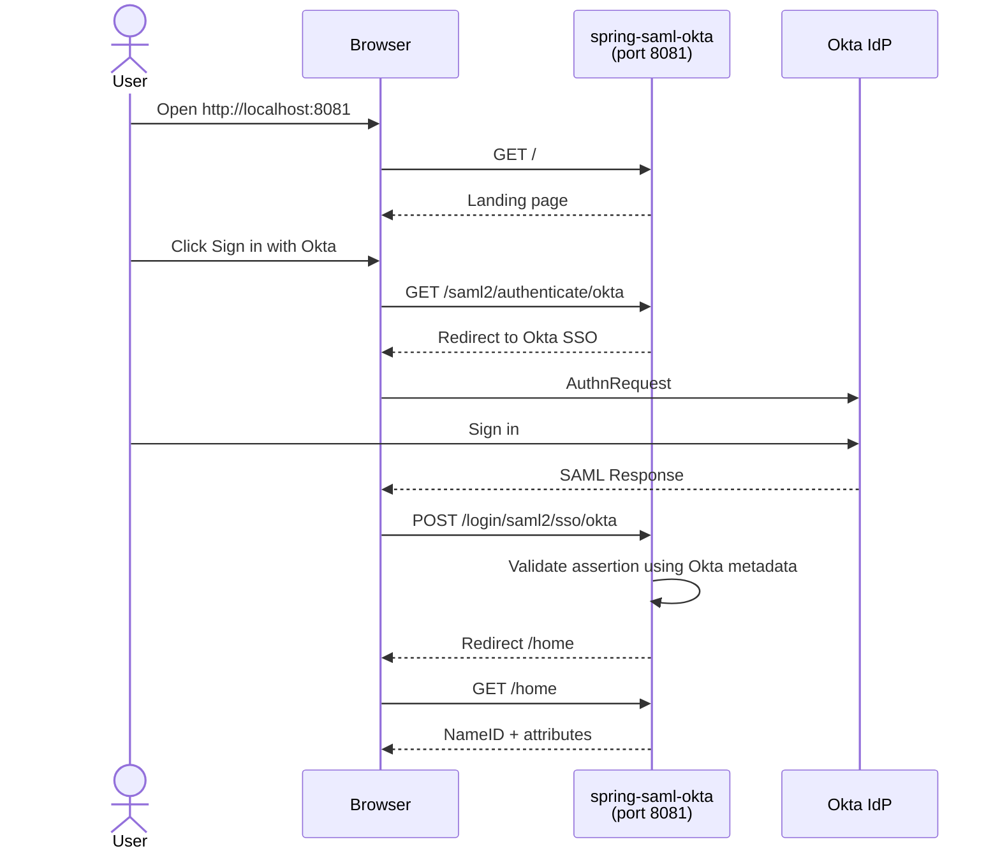

# Chapter 2: Spring SAML With Okta

Okta-focused SAML 2.0 **Service Provider** on the same Spring Boot 3.5 / Java 21 / Spring Security SAML2 stack as Chapter 1, with Okta app-integration steps and metadata URL configuration.

Originally imported from [`blaze-b/okta-spring-boot-saml-example`](https://github.com/blaze-b/okta-spring-boot-saml-example) and modernized (no committed keystore or default passwords).

## What You Will Learn

- How to create a SAML 2.0 app integration in Okta for a local Spring SP
- Which ACS and Audience values Okta expects for this module (port `8081`)
- How `OKTA_METADATA_URL` feeds Spring’s asserting-party metadata
- How this chapter differs from the generic [`spring-saml`](../spring-saml/README.md) module

## Architecture / Flow



## Configuration

Defaults live in [`src/main/resources/application.yml`](src/main/resources/application.yml).

| Property / Env | Default | Description |
| --- | --- | --- |
| `server.port` / `SERVER_PORT` | `8081` | HTTP port (avoids clash with Chapter 1) |
| `OKTA_METADATA_URL` | (falls back below) | Okta “Identity Provider metadata” HTTPS URL |
| `SAML_IDP_METADATA` | `file:local/saml/idp-metadata.xml` | Fallback metadata URI |
| `SAML_SP_PRIVATE_KEY` | `file:local/saml/sp.key` | SP private key location |
| `SAML_SP_CERTIFICATE` | `file:local/saml/sp.crt` | SP certificate location |
| Entity ID / ACS | `{baseUrl}/saml2/metadata/{registrationId}` and `{baseUrl}/login/saml2/sso/{registrationId}` | Registration id `okta` |

Prefer `OKTA_METADATA_URL` for live Okta tenants; use the file fallback for offline metadata XML.

## How To Run Against A Test IdP (Okta)

### 1. Generate A Local SP Keypair

From the `spring-saml-okta` directory:

```bash
mkdir -p local/saml
openssl genrsa -out local/saml/sp.key 2048
openssl req -new -x509 -key local/saml/sp.key -out local/saml/sp.crt -days 365 \
  -subj "/CN=localhost"
```

Files under `local/saml/` are gitignored.

### 2. Create A SAML 2.0 App In Okta

1. Sign in to the [Okta Admin Console](https://developer.okta.com/).
2. **Applications → Applications → Create App Integration** → **SAML 2.0**.
3. Configure:

| Okta Setting | Value |
| --- | --- |
| Single Sign-On URL (ACS) | `http://localhost:8081/login/saml2/sso/okta` |
| Audience URI (SP Entity ID) | `http://localhost:8081/saml2/metadata/okta` |
| Name ID format | EmailAddress or Unspecified |

4. Optionally upload `local/saml/sp.crt` as the SP signing certificate.
5. On the app **Sign On** tab, copy the **Identity Provider metadata** URL.
6. Assign a user under **Assignments**.

Historical UI screenshots (labels may differ today) live in [`docs/screenshots/`](docs/screenshots/).

### 3. Point The App At Okta Metadata

```bash
export OKTA_METADATA_URL='https://YOUR_OKTA_DOMAIN/app/exk.../sso/saml/metadata'
```

Or download the XML to `local/saml/idp-metadata.xml`.

### 4. Start The App

```bash
./mvnw -pl spring-saml-okta spring-boot:run
```

Open [http://localhost:8081](http://localhost:8081) → **Sign in with Okta**.

| Endpoint | Purpose |
| --- | --- |
| `/` | Public landing page |
| `/saml2/authenticate/okta` | Start SSO |
| `/saml2/metadata/okta` | SP metadata |
| `/home` | Assertion attributes |
| `/logout` | Logout |

### 5. Tests (No Live Okta Tenant)

```bash
./mvnw -pl spring-saml-okta,sso-test-support test
```

Throwaway keys are generated at runtime by [`sso-test-support`](../sso-test-support/).

## Key Classes

| Class | Role |
| --- | --- |
| [`OktaSamlApplication`](src/main/java/com/blazeb/sso/okta/OktaSamlApplication.java) | Spring Boot entry point |
| [`SecurityConfig`](src/main/java/com/blazeb/sso/okta/config/SecurityConfig.java) | `saml2Login` / `saml2Logout` filter chain |
| [`PageController`](src/main/java/com/blazeb/sso/okta/web/PageController.java) | `/` and `/home` |
| [`OktaSamlApplicationTests`](src/test/java/com/blazeb/sso/okta/OktaSamlApplicationTests.java) | Context-load smoke tests |

## Compared With Chapter 1

| | Chapter 1 (`spring-saml`) | Chapter 2 (`spring-saml-okta`) |
| --- | --- | --- |
| Focus | Generic SAML2 SP | Okta app walkthrough |
| Default port | `8080` | `8081` |
| Metadata env | `SAML_IDP_METADATA` | Prefer `OKTA_METADATA_URL` |

## Troubleshooting

| Symptom | Things To Check |
| --- | --- |
| App fails to start | Missing `local/saml/sp.key` / `sp.crt`, or invalid `OKTA_METADATA_URL` |
| Okta “Invalid ACS URL” | Must be `http://localhost:8081/login/saml2/sso/okta` (port **8081**) |
| Audience mismatch | Entity ID must be `http://localhost:8081/saml2/metadata/okta` |
| User cannot sign in | Assign the user to the Okta app |
| Works in Chapter 1 but not here | Confirm you did not paste Chapter 1’s port `8080` values into this Okta app |

## Navigation

| | |
| --- | --- |
| Previous | [Chapter 1: Spring SAML](../spring-saml/README.md) |
| Next | — (more chapters planned) |
| Overview | [Spring Boot SSO Learning](../README.md) |
| Basics | [Chapter 0: SSO And SAML Basics](../docs/chapter-0-sso-and-saml-basics.md) |
