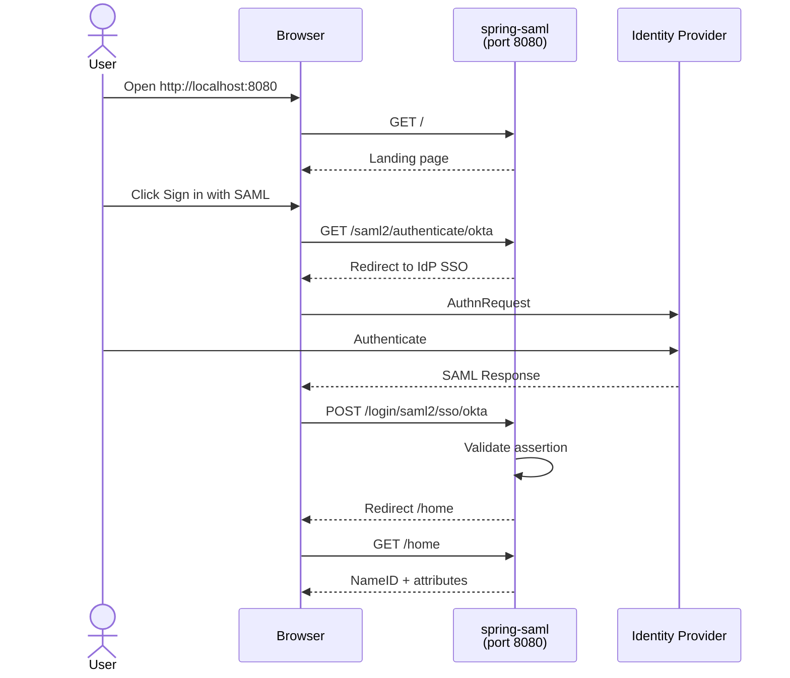

# Chapter 1: Spring SAML

Generic SAML 2.0 **Service Provider** using Spring Boot 3.5, Java 21, and Spring Security’s built-in SAML2 support.

## What You Will Learn

- How to configure a relying-party registration with properties / env vars
- How SP signing credentials and IdP metadata wire into `saml2Login`
- The Spring Security endpoints for login, ACS, metadata, and logout
- How to display assertion attributes after a successful SSO

## Architecture / Flow



## Configuration

Defaults live in [`src/main/resources/application.yml`](src/main/resources/application.yml).

| Property / Env | Default | Description |
| --- | --- | --- |
| `server.port` / `SERVER_PORT` | `8080` | HTTP port |
| `spring.security.saml2.relyingparty.registration.okta.entity-id` | `{baseUrl}/saml2/metadata/{registrationId}` | SP Entity ID |
| `…registration.okta.acs.location` | `{baseUrl}/login/saml2/sso/{registrationId}` | ACS URL |
| `SAML_SP_PRIVATE_KEY` | `file:local/saml/sp.key` | SP private key location |
| `SAML_SP_CERTIFICATE` | `file:local/saml/sp.crt` | SP certificate location |
| `SAML_IDP_METADATA` | `file:local/saml/idp-metadata.xml` | IdP metadata URI (file or HTTPS URL) |

The registration id `okta` is arbitrary. If you rename it, update IdP ACS / Audience values to match.

## How To Run Against A Test IdP

### 1. Generate A Local SP Keypair

From the `spring-saml` directory (do **not** commit these files):

```bash
mkdir -p local/saml
openssl genrsa -out local/saml/sp.key 2048
openssl req -new -x509 -key local/saml/sp.key -out local/saml/sp.crt -days 365 \
  -subj "/CN=localhost"
```

### 2. Register The SP With Your IdP

| IdP Setting | Value |
| --- | --- |
| Single Sign-On URL (ACS) | `http://localhost:8080/login/saml2/sso/okta` |
| Audience URI (SP Entity ID) | `http://localhost:8080/saml2/metadata/okta` |
| Name ID format | EmailAddress or Unspecified |

Upload `local/saml/sp.crt` if the IdP requires an SP signing certificate. Save IdP metadata as `local/saml/idp-metadata.xml`, or set `SAML_IDP_METADATA` to the IdP metadata URL.

### 3. Start The App

From the repo root:

```bash
./mvnw -pl spring-saml spring-boot:run
```

Open [http://localhost:8080](http://localhost:8080) → **Sign in with SAML**.

| Endpoint | Purpose |
| --- | --- |
| `/` | Public landing page |
| `/saml2/authenticate/okta` | Start SSO |
| `/saml2/metadata/okta` | Download SP metadata |
| `/home` | Post-login attributes |
| `/logout` | Logout |

### 4. Tests (No Live IdP)

```bash
./mvnw -pl spring-saml,sso-test-support test
```

Throwaway keys and mock IdP metadata are generated at runtime by [`sso-test-support`](../sso-test-support/).

## Key Classes

| Class | Role |
| --- | --- |
| [`SamlServiceProviderApplication`](src/main/java/com/blazeb/sso/saml/SamlServiceProviderApplication.java) | Spring Boot entry point |
| [`SecurityConfig`](src/main/java/com/blazeb/sso/saml/config/SecurityConfig.java) | `saml2Login` / `saml2Logout` filter chain |
| [`PageController`](src/main/java/com/blazeb/sso/saml/web/PageController.java) | `/` and `/home`; reads `Saml2AuthenticatedPrincipal` |
| [`SamlServiceProviderApplicationTests`](src/test/java/com/blazeb/sso/saml/SamlServiceProviderApplicationTests.java) | Context-load smoke tests |

## Troubleshooting

| Symptom | Things To Check |
| --- | --- |
| App fails to start with missing key / cert | Generate `local/saml/sp.key` and `sp.crt`; confirm paths / env vars |
| Redirect to IdP then error | ACS and Audience must match registration id and port `8080` |
| Signature / credential errors | Upload the same `sp.crt` the app loads; confirm IdP metadata URI |
| Empty attributes on `/home` | Configure attribute statements on the IdP app |
| Tests fail without openssl | Install `openssl`; tests shell out to it via `sso-test-support` |

## Navigation

| | |
| --- | --- |
| Previous | [Chapter 0: SSO And SAML Basics](../docs/chapter-0-sso-and-saml-basics.md) |
| Next | [Chapter 2: Spring SAML With Okta](../spring-saml-okta/README.md) |
| Overview | [Spring Boot SSO Learning](../README.md) |
